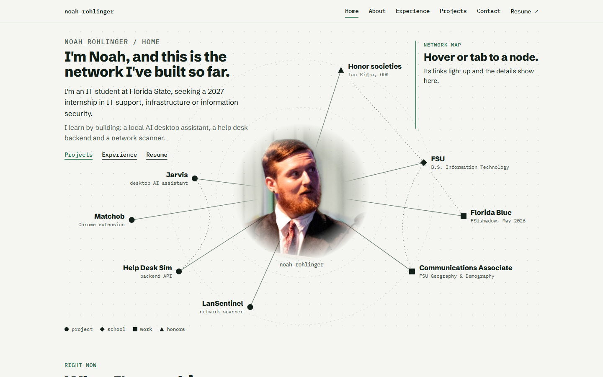
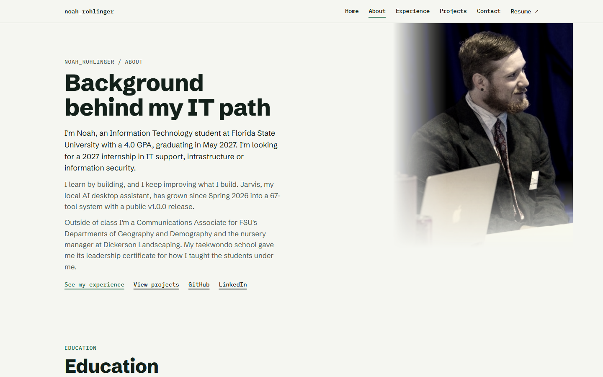
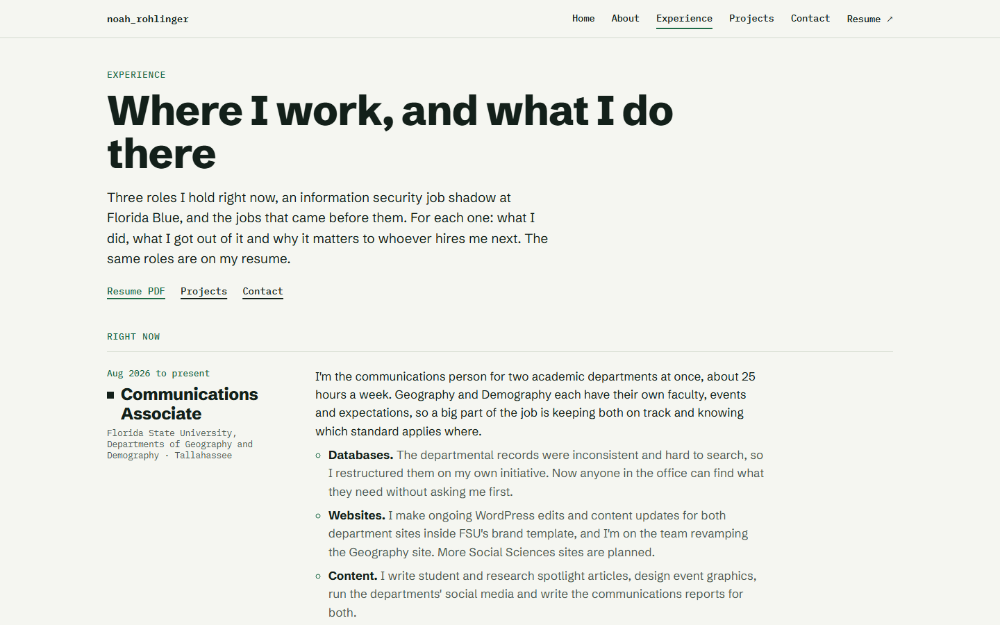
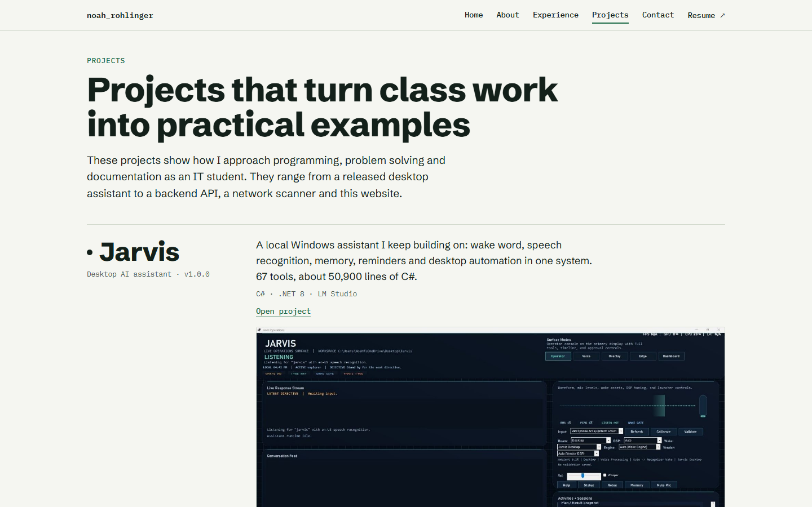
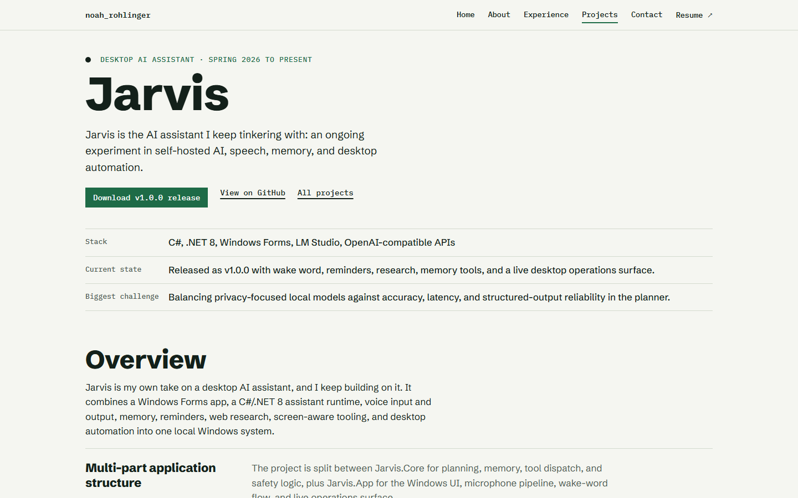
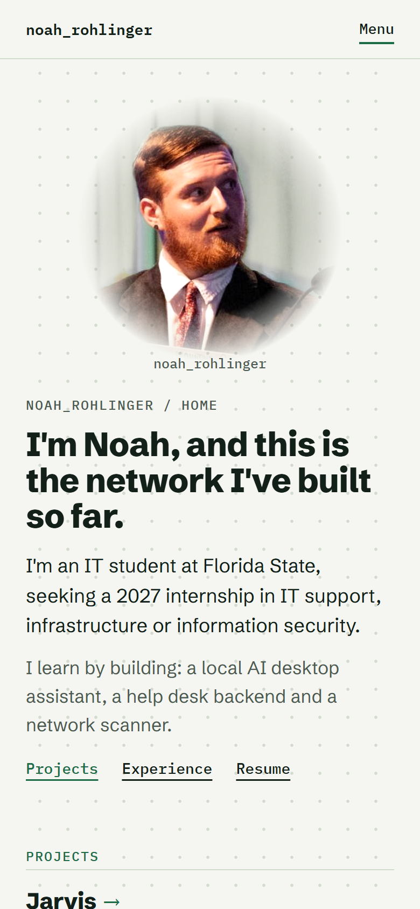

# Noah Rohlinger | IT Portfolio

**Live site: [noahrohling.netlify.app](https://noahrohling.netlify.app)**

My personal portfolio. I'm an Information Technology student at Florida State University looking for a 2027 internship in IT support, infrastructure or information security. The site covers my experience, my projects (Jarvis, Matchob, Help Desk Sim, LanSentinel) and how to reach me.



## Pages

| Page | What's on it |
| --- | --- |
| [Home](https://noahrohling.netlify.app/) | A network map of my projects, school, work and honors. Hover or tab to a node to see how it connects. |
| [About](https://noahrohling.netlify.app/about.html) | Education, skills, certificates, clubs and a timeline. |
| [Experience](https://noahrohling.netlify.app/experience.html) | Each role: what I did, what I got out of it and why it matters. |
| [Projects](https://noahrohling.netlify.app/projects.html) | Every project, with a page of its own for each. |
| [Jarvis](https://noahrohling.netlify.app/jarvis.html) | My local AI desktop assistant, with a scroll-through diagram of how it works. |
| [Contact](https://noahrohling.netlify.app/contact.html) | A form that opens a ready-to-send email in Gmail or your email app. |

| About | Experience |
| --- | --- |
|  |  |
| **Projects** | **Jarvis** |
|  |  |

On a phone:



## How it's built

- Plain HTML, CSS and a little JavaScript. No framework and no build step.
- One shared stylesheet (`site.css`); each page keeps its own page-specific styles.
- Works on phones, with a menu button below desktop width.
- Animations turn off for anyone who has reduced motion set on their device.
- The contact form doesn't send anything to a server. It builds the email and opens it in Gmail or your email app.
- Hosted on Netlify.

## Run it locally

Open `index.html` in a browser, or serve the folder:

```
python -m http.server 8000
```

Then go to http://localhost:8000.
